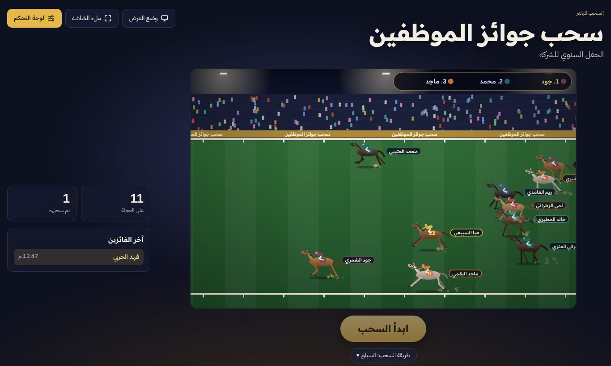
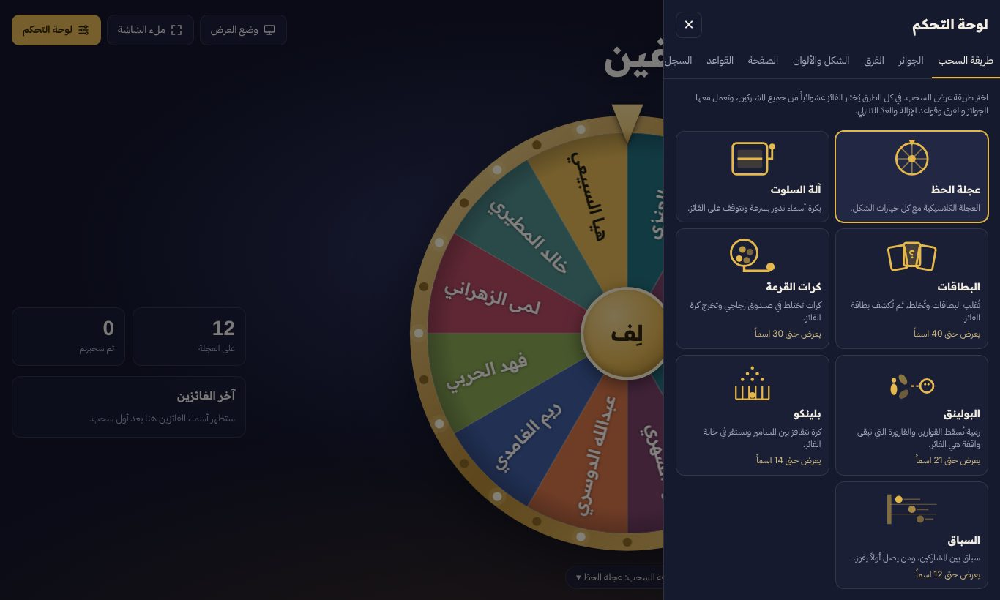

# عجلة الحظ: سحب الموظفين

برنامج سحب عشوائي بالعربية للحفلات والفعاليات، يعمل من ملف واحد في المتصفح دون تثبيت أو خادم. يدعم سبع طرق للسحب، مع لوحة تحكم لإدارة الموظفين والجوائز والفرق وشكل الصفحة.

## طرق السحب

| الطريقة | الوصف |
|---|---|
| عجلة الحظ | العجلة الكلاسيكية مع تحكم كامل في الشكل والشفافية والإطار والمؤشر |
| آلة السلوت | بكرة أسماء أسطوانية تدور وتتوقف على الفائز، وتتساقط عملات عند الفوز |
| البطاقات | تُقلب البطاقات وتُخلط وتوزّع، ثم يكشف ضوء كشّاف بطاقة الفائز |
| كرات القرعة | كرات تختلط في أسطوانة زجاجية دوّارة وتخرج كرة الفائز عبر أنبوب |
| البولينق | مشهد ثلاثي الأبعاد: تسقط القوارير وتبقى قارورة الفائز واقفة |
| بلينكو | كرة تتقافز بين المسامير وتستقر في خانة الفائز |
| السباق | سباق خيول بكاميرا تلاحق المتصدر، ومن يصل أولاً يفوز |

في كل الطرق يُختار الفائز عشوائياً من جميع المشاركين باستخدام `crypto.getRandomValues`. الحركة على الشاشة تُعرض للوصول إلى نتيجة محسومة مسبقاً، فلا تؤثر الرسوم على عدالة السحب. بعض الطرق تعرض عدداً محدوداً من الأسماء على الشاشة (السباق 12، وبلينكو 14، والبولينق 21، والقرعة 30، والبطاقات 40)، وعندها تظهر عينة عشوائية، والفائز يبقى من الجميع.

## لوحة التحكم

- **المشاركون:** إضافة جماعية أو استيراد ملف `.txt` أو `.csv`، وتعديل وحذف وبحث، ومنع التكرار، وفرص مختلفة لكل موظف (اكتب `الاسم*3`).
- **الجوائز:** قائمة جوائز بكميات وترتيب، وكل سحب يمنح الجائزة التالية.
- **الفرق:** من 2 إلى 12 فريقاً بأسماء وألوان، وثلاث طرق للتوزيع.
- **الشكل والألوان:** شفافية العجلة والإطار، والحجم، ونمط الشرائح، والمؤشر، ولوحات ألوان، وألوان مخصصة لهوية شركتك.
- **الصفحة:** عنوان الفقرة، وصورة خلفية مع تعتيم وتمويه، وشعار في الوسط، ورسالة الفوز.
- **القواعد:** إزالة الفائز تلقائياً أو بسؤالك أو إبقاؤه، وسحب عدة فائزين دفعة واحدة، ومدة الحركة، وعدّ تنازلي، وإغلاق تلقائي لنافذة الفائز، والصوت.
- **السجل:** كل الفائزين بالترتيب، مع نسخ كجدول يُلصق في Excel.
- **نسخة احتياطية:** رمز يحفظ كل الإعدادات ويسترجعها على أي جهاز.

اختصارات لوحة المفاتيح: <kbd>مسافة</kbd> لبدء السحب، و<kbd>P</kbd> لوضع العرض، و<kbd>Esc</kbd> للإغلاق.

## التشغيل

**على جهازك:** نزّل `index.html` وافتحه في أي متصفح حديث.

**كموقع مجاني عبر GitHub Pages:**

1. ارفع الملفات إلى مستودع جديد على GitHub.
2. من المستودع افتح **Settings** ثم **Pages**.
3. تحت **Build and deployment** اختر **Deploy from a branch**، ثم الفرع `main` والمجلد `/ (root)`، واضغط **Save**.
4. بعد دقيقة تقريباً يظهر رابط الموقع بالشكل `https://اسم-المستخدم.github.io/اسم-المستودع/`.

## ملاحظات

- الأسماء والإعدادات تُحفظ في متصفح الجهاز نفسه فقط (`localStorage`)، ولا تُرسل إلى أي خادم. لنقلها إلى جهاز آخر استخدم النسخة الاحتياطية من قسم القواعد.
- الخطوط (Readex Pro وIBM Plex Sans Arabic) تُحمّل من Google Fonts، فتحتاج اتصالاً بالإنترنت لتظهر كما في الصور. بدون اتصال يعمل البرنامج بخط النظام.
- لا يعتمد على أي مكتبات خارجية.

## الترخيص

مرخّص بموجب [MIT](LICENSE).

